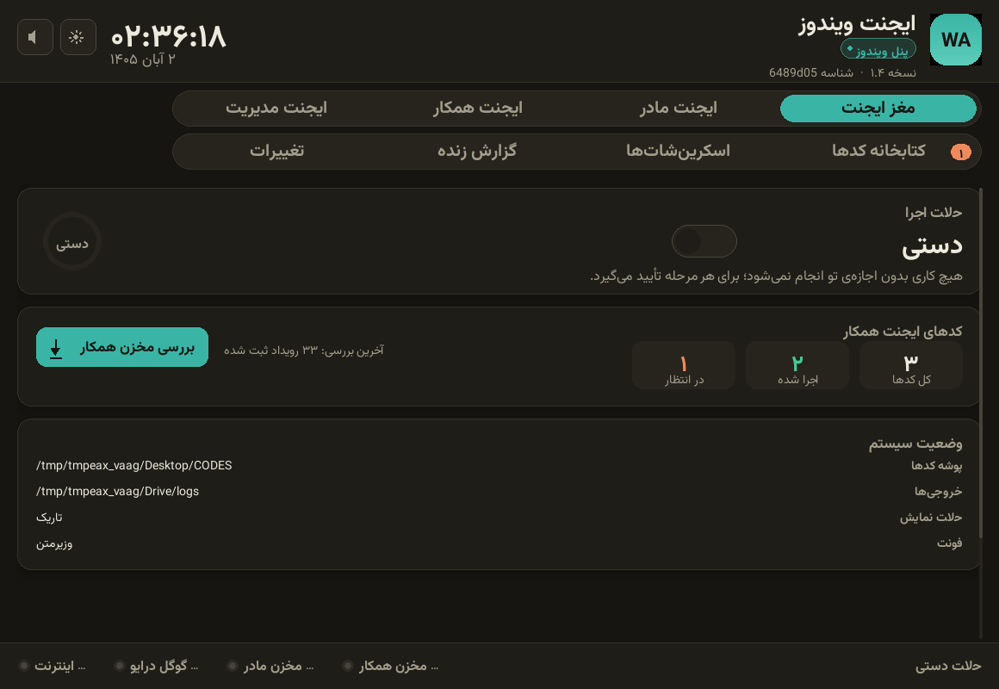
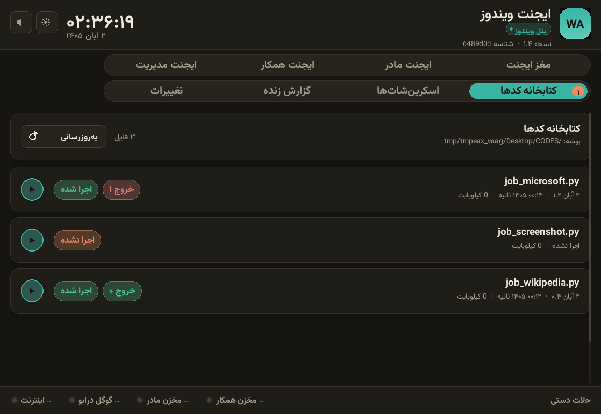
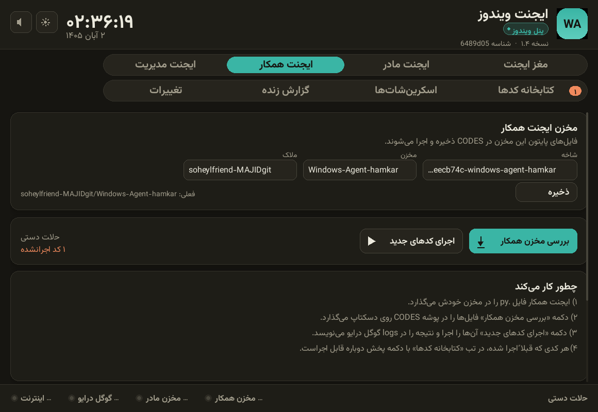
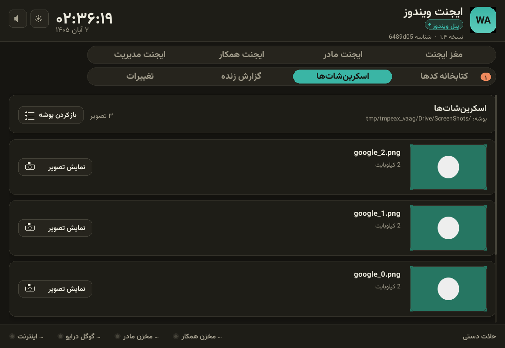
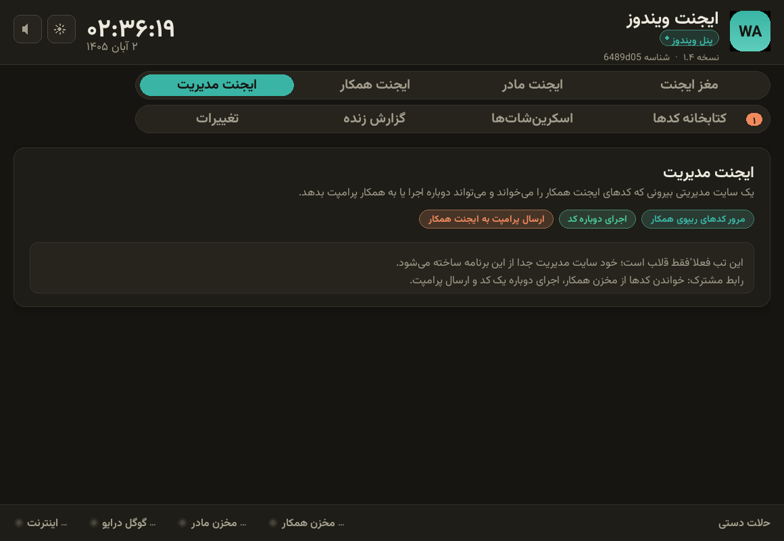

# Windows Agent

ابزار اتوماسیون دسکتاپ ویندوز با رابط کاربری ساده.

نسخه فعلی: **۱.۵ — رابط کاربری pygame**

---

## معماری

دو ایجنت داریم:

```
┌─────────────────┐        ┌──────────────────────┐
│  ایجنت مادر     │        │  ایجنت همکار         │
│  (این مخزن)     │        │  (مخزن جداگانه خودش) │
│  app.py/run.bat │        │  فقط فایل .py        │
└────────┬────────┘        └──────────┬───────────┘
         │ نسخه برنامه               │ کدهای پایتون
         └───────────┬───────────────┘
                     ▼
          ┌────────────────────┐
          │  برنامه روی ویندوز │
          │  Desktop\CODES     │
          └─────────┬──────────┘
                    ▼
        اجرا → نتیجه در Google Drive\logs
```

ایجنت همکار به سورس برنامه دسترسی ندارد؛ فقط کد پایتون می‌نویسد.

## مخزن ایجنت همکار (تنظیم‌شده)

| مورد | مقدار |
|---|---|
| مالک | `soheylfriend-MAJIDgit` |
| مخزن | `Windows-Agent-hamkar` |
| شاخه | `arena/beecb74c-windows-agent-hamkar` |
| فایل کد | `job_wikipedia.py` (ریشه) |

## ساختار این مخزن

```
Windows-Agent/
├── app.py          ← برنامه (رابط کاربری pygame)
├── run.bat         ← نصب کتابخانه‌ها + اجرا
├── version.txt     ← شماره نسخه
└── assets/
    ├── fonts/      ← وزیرمتن
    └── sounds/     ← افکت‌های صوتی (wav)
```

## هشت تب

| تب | کار |
|---|---|
| **مغز ایجنت** | کلید دستی/خودکار، آمار کدها، وضعیت سیستم |
| **ایجنت مادر** | محل ایجنت مادر (خالی، برای نسخه بعد) |
| **ایجنت همکار** | تنظیم مخزن همکار + دریافت و اجرای کدها |
| **ایجنت مدیریت** | قالب سایت مدیریتی که کدها را می‌خواند و پرامپت می‌دهد |
| **کتابخانه کدها** | فهرست کامل کدها با دکمه پخش برای اجرای مجدد |
| **اسکرین‌شات‌ها** | تصویرهای پوشه ScreenShots با پیش‌نمایش |
| **گزارش زنده** | لاگ برنامه دوستونه، پاک‌کردن |
| **تغییرات** | تاریخچه نسخه‌ها |

> پرامپت ساخت ایجنت مدیریت: [`docs/manager-agent-prompt.md`](docs/manager-agent-prompt.md)

## به‌روزرسانی برنامه

برنامه **هیچ نسخه‌ای را خودش از گیت‌هاب نمی‌گیرد**. برای نسخه جدید، پروژه را با
GitHub Desktop به‌روزرسانی کن (Pull) و `run.bat` را دوباره اجرا کن.

## رابط کاربری (pygame)








همه اجزا با pygame کشیده می‌شوند — نه Tkinter.

- **گرافیک برداری**: کارت‌های گرد، سایه نرم، هاور، انیمیشن سوییچ
- **تم تاریک/روشن** با کلید ☀/🌙 در هدر (انتخاب ذخیره می‌شود)
- **افکت صوتی** برای هر مرحله:

| صدا | کجا |
|---|---|
| `click` | کلیک روی دکمه‌ها و تب‌ها |
| `toggle` | کلید حالت و صدا |
| `open` | شروع عملیات (باز کردن سایت/مخزن) |
| `run` | شروع اجرای کد |
| `success` / `error` | پایان موفق یا خطا |
| `shutter` | گرفتن اسکرین‌شات |
| `tick` | سه ثانیه آخر شمارش معکوس |
| `notify` | نمایش پنجره تأیید |

- **تایمر دایره‌ای** در کارت «حالت اجرا»: هر ۱۰ ثانیه یک دور، با شمارش معکوس و حلقه رنگی
- **تب «کتابخانه کدها»**: فهرست همه فایل‌های پایتون پوشه CODES با وضعیت اجرا و **دکمه پخش** برای اجرای مجدد هر کدام
- کلید قطع صدا 🔈/🔇 در هدر

## رابط کاربری

- تم **تاریک** (پیش‌فرض) و **روشن** با کلید ☀/🌙 در هدر؛ انتخاب ذخیره می‌شود.
- فونت **وزیرمتن** همراه برنامه است و بدون نصب روی سیستم بارگذاری می‌شود.
- سه تب کپسولی: عملیات · ایجنت همکار · آخرین تغییرات.
- کلید کشویی گرد برای حالت دستی/خودکار.
- ساعت و تاریخ جلالی زنده در هدر.
- دو مخزن قابل تنظیم: **ایجنت مادر** (خود برنامه) و **ایجنت همکار** (کدها).

پوشه `codes` **حذف شده است**. کدها فقط از مخزن ایجنت همکار می‌آیند.

## گوگل درایو (فقط دو پوشه)

```
My Drive\Windows-Agent-DB\
├── ScreenShots\    ← عکس‌ها
└── logs\
    ├── گزارش‌ها و نتیجه اجرای کدها (*_result.txt)
    └── errors\     ← همه خطاها و مشکلات
```

## هیچ فایلی کنار برنامه نوشته نمی‌شود

پوشه برنامه فقط `app.py` و `run.bat` است. فایل‌های وضعیت در این مسیر هستند:

```
%LOCALAPPDATA%\Windows-Agent\
├── settings.json      ← حالت دستی/خودکار و مخزن همکار
├── codes_state.json   ← کدام فایل‌ها اجرا شده‌اند
├── build_stamp.json   ← شناسه نسخه
└── backups\           ← پشتیبان app.py قبل از هر بروزرسانی
```

و هر خطایی — خطای دریافت مخزن، خطای اجرای کد، خطای بالا نیامدن برنامه —
در `logs\errors\errors_<تاریخ جلالی>.txt` گوگل درایو ثبت می‌شود.

## چطور کار می‌کند

1. برنامه موقع باز شدن، پوشه `Desktop\CODES` را چک می‌کند و اگر نبود می‌سازد.
2. مخزن ایجنت همکار بررسی می‌شود (مخزن و شاخه داخل خود برنامه قابل تنظیم است).
3. هر فایل `.py` جدید در پوشه `CODES` ذخیره می‌شود.
4. همان فایل اجرا می‌شود و نتیجه در `logs` گوگل درایو نوشته می‌شود.

## یک کلید: دستی یا خودکار

| حالت | رفتار |
|---|---|
| **🔒 دستی** (پیش‌فرض) | هیچ کاری بدون اجازه تو انجام نمی‌شود؛ برای هر فایل و هر اجرا از تو می‌پرسد |
| **⚡ خودکار** | بررسی مخزن، دانلود و اجرا هر ۱۰ ثانیه بدون پرسیدن انجام می‌شود |

انتخابت در `settings.json` ذخیره می‌شود.

## اجرا

1. `run.bat` را دوبار کلیک کن. اگر `pygame` یا `arabic-reshaper` یا `python-bidi` یا `Pillow` نصب نباشد، **خودش نصب می‌کند** و بعد برنامه را باز می‌کند.
2. در تب **ایجنت همکار**، مالک / مخزن / شاخه را وارد کن و «💾 ذخیره» بزن.
3. دکمه «📥 بررسی مخزن همکار» → فایل‌ها در `CODES` ذخیره می‌شوند.
4. دکمه «▶️ اجرای کدهای جدید» → اجرا و نتیجه در `logs`.

## نکته‌ها

- پروکسی سیستم ویندوز (مثل v2rayN) خودکار شناسایی می‌شود.
- هر فایل فقط یک بار اجرا می‌شود؛ اگر محتوایش عوض شود دوباره اجرا می‌شود.
- نام فایل‌ها با تاریخ جلالی و ساعت تهران است.
